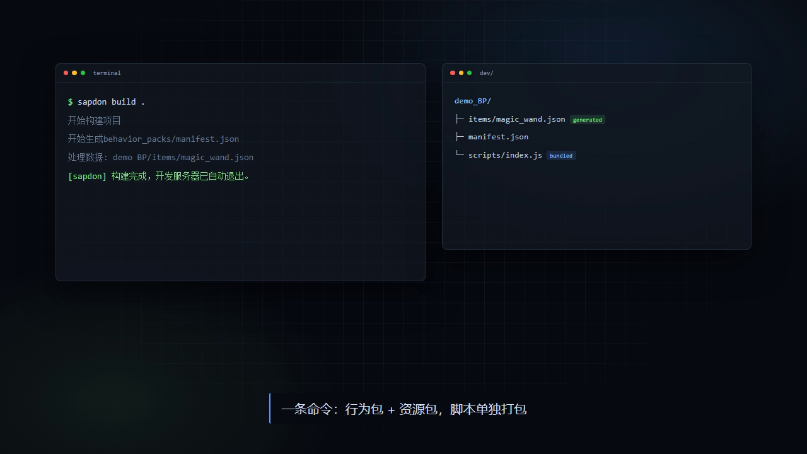

<p align="center">
  
</p>

<h1 align="center">Sapdon</h1>

<p align="center">
  <b>Sapdon is an addon development framework for Minecraft Bedrock Edition.</b><br />
  Declare items, blocks, entities and screens in TypeScript. One command produces the behavior and resource packs.<br />
  JSON is generated at build time from typed APIs, so you stop hand-writing config files.
</p>

<p align="center"><sub>Items · Blocks · Entities · Recipes · Forms · In-game books · World generation</sub></p>

<p align="center">
  <a href="https://www.npmjs.com/package/sapdon"></a>
  <a href="./LICENSE"></a>
  <a href="https://nodejs.org/"></a>
  <a href="https://qm.qq.com/q/2HrXHcKq9j"></a>
</p>

<p align="center">
  <a href="./doc/en/quick-start.md">Quick start</a> ·
  <a href="./doc/en/README.md">Docs</a> ·
  <a href="./doc/media/sapdon-intro.mp4">36s intro</a> ·
  <a href="./README.md">简体中文</a> ·
  <a href="./CHANGELOG.md">Changelog</a>
</p>

## An item in five lines of TypeScript

```typescript
import { ItemAPI, ItemCategory, ItemComponent, registry } from '@sapdon/core'

ItemAPI.createItem('demo:magic_wand', ItemCategory.Items, 'magic_wand')
  .addComponent(ItemComponent.setDisplayName('Magic Wand'))
  .addComponent(ItemComponent.setInteractButton('Cast'))

registry.submit()
```

After a build, `dev/` contains:

```text
dev/demo_BP/items/magic_wand.json   ← standard JSON, read directly by the game
dev/demo_BP/manifest.json           ← UUIDs and module dependencies
dev/demo_RP/manifest.json
dev/demo_BP/scripts/index.js        ← runtime scripts bundled into one file
```

Field names come from TypeScript types, so a typo fails at compile time instead of silently producing nothing in game. Both packs, the script bundle and the sync to the game folder come from one command:

```bash
sapdon build .
```



## Features

- **Declarative API** — items, blocks, entities, recipes, screens, in-game books and world generation all follow the same shape: create an object, add components, call `registry.submit()`
- **Type safety** — API and component fields are typed; mistakes surface at compile time, not after launching the game
- **One build, two packs** — behavior pack, resource pack and script bundle are generated together and synced to the Minecraft development folder
- **Build time and runtime stay separate** — `@sapdon/core` runs in Node only, `@sapdon/runtime` ships into the game, so a runtime script cannot accidentally import build-time code
- **Hot reload** — `sapdon build` watches files and rebuilds; `sapdon compile` builds once for packaging
- **Runnable examples** — 17 projects covering everything from a single item to circuits, fluid pipes and in-game books

## Requirements

- Node.js 18 or newer
- Minecraft Bedrock Edition
- Any package manager; examples use npm

## Installation

Install as a project dependency, not a global CLI:

```bash
npm install -D sapdon
```

## Quick start

```bash
npx sapdon create my_addon    # choose the JS or TS template
cd my_addon
sapdon build .                # generate, bundle, sync to the game
```

Both packs land in `dev/`:

```
dev/
├── my_addon_BP/              # behavior pack
│   ├── items/ blocks/ entities/ recipes/
│   ├── manifest.json
│   └── scripts/index.js      # runtime scripts, bundled
└── my_addon_RP/              # resource pack
    ├── textures/ texts/ ui/
    └── manifest.json
```

| Command | What it does |
|---|---|
| `sapdon build .` | Build and start watching files |
| `sapdon compile` | Build once and exit, for packaging |
| `sapdon pack` | Zip both packs into a `.mcaddon` |
| `sapdon lib` | Copy `prod/` libraries into `node_modules` (framework dev / 3.x; not needed for 4.0 projects) |

## Build time and runtime

The two layers use different dependencies, and mixing them breaks the pack:

| | Build time | Runtime |
|---|---|---|
| Entry | `main.ts` | `scripts/index.ts` |
| Runs in | Node.js | Minecraft script engine |
| May import | `@sapdon/core` | `@sapdon/runtime`, `@minecraft/server` |
| Responsibility | Generate JSON, bundle scripts | Events, custom components, persistence |

Importing `@sapdon/core` from a runtime script leaves an unresolvable package name in the bundle. The game then refuses to load the entire script, with no more than a line in the content log.

Registering a custom component at runtime:

```typescript
// scripts/index.ts
import { registerBlockComponent } from '@sapdon/runtime'

registerBlockComponent('demo:machine_tick', {
  onTick: ({ block }) => { /* ... */ },
  onPlayerInteract: ({ player }) => player?.sendMessage('used'),
})
```

## What you can build

| Content | API | Notes |
|---|---|---|
| Items | `ItemAPI` | Basic items, food, armor, attachables, flipbook items |
| Blocks | `BlockAPI` | Six-face textures, variants, rotation, crops, ores, glass, stairs, blocks with entities |
| Entities | `EntityAPI` | Behavior and resource packs generated together; AI goals, projectiles, display entities |
| Recipes | `RecipeAPI` | Shaped, shapeless, furnace; shorthand and chained styles |
| Forms | `SapdonFormUI` | Content panel, button panel, button grid, paged lists |
| In-game books | `SapdonGuideBook` | Three-level contents, entries, paging, localization |
| World generation | `BiomeAPI` / `FeatureAPI` | Biomes, features, ore veins |

## Documentation

The English edition covers day-to-day authoring:

- [Quick start](./doc/en/quick-start.md) · [Configuration](./doc/en/configuration.md) · [FAQ](./doc/en/faq.md)
- Tutorials: [Items](./doc/en/tutorials/item.md) · [Blocks](./doc/en/tutorials/block.md) · [Entities](./doc/en/tutorials/entity.md) · [Recipes](./doc/en/tutorials/recipe.md) · [UI](./doc/en/tutorials/sapdon-ui.md)
- Guides: [Textures](./doc/en/guides/textures.md) · [Runtime scripts](./doc/en/guides/scripts.md) · [Packaging](./doc/en/guides/packaging.md)

The complete API reference (`doc/user/api/`), the configuration reference (`doc/user/config/`) and the framework internals (`doc/dev/`) are currently Chinese only. The full documentation index is [doc/en/README.md](./doc/en/README.md).

## Examples

Every directory under `examples/` is a buildable project:

| Directory | What it shows |
|---|---|
| `items_demo`, `block_demo` | Item and block variants |
| `more-golem`, `gomoku` | Entities, AI and behavior pack layout |
| `test_ui`, `guidebook_demo` | Form page shells and the in-game book |
| `digitCircuit`, `fluid_pipe`, `power_grid` | Runtime components, chunked persistence, complex interaction |
| `vanilla_recreation` | Recreations of vanilla content |

## Contributing

Issues and pull requests are welcome.

- Framework changes go in `src/`; run `npm run build` afterwards to rebuild `prod/`
- Read [workflow](./doc/dev/workflow.md) and [known pitfalls](./doc/dev/known-pitfalls.md) before touching the framework
- Documentation changes should follow the [writing guide](./doc/dev/writing-guide.md)
- Run `npm test` before opening a PR

## Build from source

```bash
git clone https://github.com/Meteage/sapdon.git
cd sapdon
npm install
npm run build          # output goes to prod/
```

Use `npm run build -- verbose` for detailed logs, `npm run build -- keep` to keep the intermediate `dist/`.

## License

[MIT](./LICENSE) © 2025 Meteage
