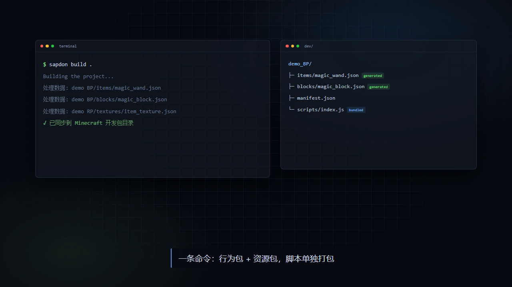

<p align="center">
  
</p>

<h1 align="center">Sapdon</h1>

<p align="center">
  <b>Sapdon 是 Minecraft Bedrock Edition 的 addon 开发框架。</b><br />
  用 TypeScript 声明物品、方块、实体和界面，一条命令生成行为包与资源包。<br />
  JSON 由构建期写出，字段由类型补全，不用再手拼配置。
</p>

<p align="center"><sub>物品 · 方块 · 实体 · 配方 · 表单界面 · 游戏内手册 · 世界生成</sub></p>

<p align="center">
  <a href="https://www.npmjs.com/package/sapdon"></a>
  <a href="./LICENSE"></a>
  <a href="https://nodejs.org/"></a>
  <a href="https://www.npmjs.com/package/sapdon"></a>
  <a href="https://qm.qq.com/q/2HrXHcKq9j"></a>
</p>

<p align="center">
  <a href="./doc/user/quick-start.md">快速开始</a> ·
  <a href="./doc/user/index.md">文档</a> ·
  <a href="./doc/media/sapdon-intro.mp4">36 秒介绍片</a> ·
  <a href="./doc/en/README.md">English</a> ·
  <a href="./CHANGELOG.md">更新日志</a>
</p>

## 一个物品，五行 TypeScript

```typescript
import { ItemAPI, ItemCategory, ItemComponent, registry } from '@sapdon/core'

ItemAPI.createItem('demo:magic_wand', ItemCategory.Items, 'magic_wand')
  .addComponent(ItemComponent.setDisplayName('魔杖'))
  .addComponent(ItemComponent.setInteractButton('施法'))

registry.submit()
```

构建之后，`dev/` 里多出这些文件：

```text
dev/demo_BP/items/magic_wand.json   ← 原版格式的 JSON，游戏直接读
dev/demo_BP/manifest.json           ← UUID 与模块依赖
dev/demo_RP/manifest.json
dev/demo_BP/scripts/index.js        ← 运行期脚本打成一份
```

字段由类型补全，参数写错在编译期就报；双包同步、脚本打包、进游戏目录都由一条命令完成。自定义贴图要先用 `ItemTextureManager.registerTexture` 登记短名，做法见[加贴图](./doc/user/guides/textures.md)。

```bash
sapdon build .
```



## 特性

- **声明式 API**：物品、方块、实体、配方、界面、手册、世界生成统一走「建对象 → 加组件 → `registry.submit()`」
- **类型安全**：API 与组件字段由 TypeScript 类型约束，写错在编译期暴露，不用等进游戏
- **一次构建产出双包**：行为包、资源包、脚本 bundle 同时生成，并同步到 Minecraft 开发包目录
- **构建期与运行期分离**：`@sapdon/core` 只跑在 Node，`@sapdon/runtime` 只进游戏，避免运行期误引构建期依赖
- **热更新**：`sapdon build` 监听文件改动自动重建；`sapdon compile` 用于出包前的一次性构建
- **开箱即用的示例**：17 个可构建项目，覆盖从单物品到电路、管道、游戏内手册

## 环境要求

- Node.js 18 或更高
- Minecraft Bedrock Edition（开发时用开发包目录，正式发布走 `.mcaddon`）
- 包管理器不限，本文以 npm 为例

## 安装

作为项目依赖安装，不写入全局 PATH：

```bash
npm install -D sapdon
```

## 快速开始

```bash
npx sapdon create my_addon    # 按提示选择 JS 或 TS 模板
cd my_addon
sapdon build .                # 生成产物、打包脚本、同步到游戏
```

构建完成后 `dev/` 下会同时出现两个包：

```
dev/
├── my_addon_BP/              # 行为包
│   ├── items/ blocks/ entities/ recipes/
│   ├── manifest.json
│   └── scripts/index.js      # 脚本单独打成一份
└── my_addon_RP/              # 资源包
    ├── textures/ texts/ ui/
    └── manifest.json
```

常用命令：

| 命令 | 作用 |
|---|---|
| `sapdon build .` | 构建并启动热更新，日常开发用 |
| `sapdon compile` | 构建一次后退出，出包前用 |
| `sapdon pack` | 把 `dev/` 下两个包压成 `.mcaddon` |
| `sapdon lib` | 重新同步框架库到 `node_modules` |

## 核心概念

框架分成两层，依赖不能混用：

| | 构建期 | 运行期 |
|---|---|---|
| 入口 | `main.ts` | `scripts/index.ts` |
| 运行在 | Node.js | Minecraft 脚本引擎 |
| 可以 import | `@sapdon/core` | `@sapdon/runtime`、`@minecraft/server` |
| 负责 | 生成 JSON、打包脚本 | 事件订阅、自定义组件、状态持久化 |

运行期脚本里 `import '@sapdon/core'` 会在产物中留下无法解析的包名，游戏加载时整份脚本不执行。反过来，构建期不参与任何游戏内逻辑。

运行期注册自定义组件：

```typescript
// scripts/index.ts
import { registerBlockComponent } from '@sapdon/runtime'

registerBlockComponent('demo:machine_tick', {
  onTick: ({ block }) => { /* ... */ },
  onPlayerInteract: ({ player }) => player?.sendMessage('交互到了'),
})
```

## 能力范围

| 内容 | API | 说明 |
|---|---|---|
| 物品 | `ItemAPI` | 基础物品、食物、盔甲、可附着物、翻书物品 |
| 方块 | `BlockAPI` | 六面贴图、多变体、可旋转、作物、矿物、玻璃、楼梯、带实体方块 |
| 实体 | `EntityAPI` | 行为包与资源包成对生成，含 AI 行为、抛射物、展示实体 |
| 配方 | `RecipeAPI` | 有序、无序、熔炉，简写与链式两套写法 |
| 表单界面 | `SapdonFormUI` | 内容面板、按键面板、按钮网格、分页列表 |
| 游戏内手册 | `SapdonGuideBook` | 三级目录、词条、翻页、多语言 |
| 世界生成 | `BiomeAPI` / `FeatureAPI` | 生物群系、地物、矿脉 |

## 文档

**上手**：[快速入门](./doc/user/quick-start.md) · [教程导读](./doc/user/index.md) · [English edition](./doc/en/README.md)

**教程**：[物品](./doc/user/tutorials/item.md) · [方块](./doc/user/tutorials/block.md) · [实体](./doc/user/tutorials/entity.md) · [配方](./doc/user/tutorials/recipe.md) · [UI](./doc/user/tutorials/sapdon-ui.md)

**任务指南**：[加贴图](./doc/user/guides/textures.md) · [让脚本跑起来](./doc/user/guides/scripts.md) · [打包与分发](./doc/user/guides/packaging.md)

**参考**：[API 索引](./doc/user/api/item.md) · [build.config](./doc/user/config/build-config.md) · [mod.info](./doc/user/config/mod-info.md) · [手册专题](./doc/guidebook.md) · [FAQ](./doc/user/faq.md)

**框架开发**：[架构](./doc/dev/architecture.md) · [Core](./doc/dev/core.md) · [CLI](./doc/dev/cli.md) · [OC 运行时](./doc/dev/oc.md) · [工作流](./doc/dev/workflow.md) · [已知坑清单](./doc/dev/known-pitfalls.md) · [文档写作规范](./doc/dev/writing-guide.md)

## 示例

`examples/` 下每个目录都是可构建项目：

| 目录 | 内容 |
|---|---|
| `items_demo`、`block_demo` | 物品与方块的各种变体 |
| `more-golem`、`gomoku` | 实体、AI 与行为包结构 |
| `test_ui`、`guidebook_demo` | 表单页面壳、游戏内手册 |
| `digitCircuit`、`fluid_pipe`、`power_grid` | 运行期组件、分块持久化、复杂交互 |
| `vanilla_recreation` | 原版内容复刻 |

## 贡献

欢迎提交 Issue 与 Pull Request。

- 改动框架源码只动 `src/`，之后执行 `npm run build` 重建 `prod/`
- 改之前先读 [开发工作流](./doc/dev/workflow.md) 与 [已知坑清单](./doc/dev/known-pitfalls.md)
- 文档改动请遵循 [文档写作规范](./doc/dev/writing-guide.md)
- 提交前跑 `npm test`

## 从源码构建

```bash
git clone https://github.com/Meteage/sapdon.git
cd sapdon
npm install
npm run build          # 产物输出到 prod/
```

`npm run build -- verbose` 查看详细日志，`npm run build -- keep` 保留中间 `dist/`。

## 许可证

[MIT](./LICENSE) © 2025 Meteage
